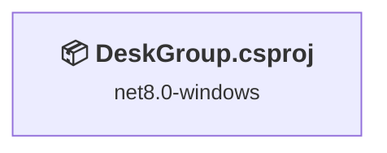
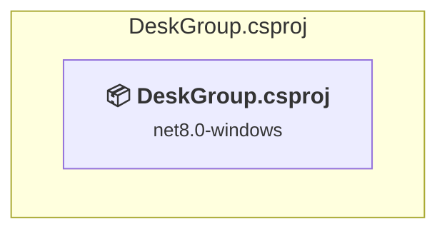

# Projects and dependencies analysis

This document provides a comprehensive overview of the projects and their dependencies in the context of upgrading to .NETCoreApp,Version=v10.0.

## Table of Contents

- [Executive Summary](#executive-Summary)
  - [Highlevel Metrics](#highlevel-metrics)
  - [Projects Compatibility](#projects-compatibility)
  - [Package Compatibility](#package-compatibility)
  - [API Compatibility](#api-compatibility)
- [Aggregate NuGet packages details](#aggregate-nuget-packages-details)
- [Top API Migration Challenges](#top-api-migration-challenges)
  - [Technologies and Features](#technologies-and-features)
  - [Most Frequent API Issues](#most-frequent-api-issues)
- [Projects Relationship Graph](#projects-relationship-graph)
- [Project Details](#project-details)

  - [src\DeskGroup\DeskGroup.csproj](#srcdeskgroupdeskgroupcsproj)

## Executive Summary

### Highlevel Metrics

| Metric | Count | Status |
| :--- | :---: | :--- |
| Total Projects | 1 | All require upgrade |
| Total NuGet Packages | 3 | 1 need upgrade |
| Total Code Files | 34 |  |
| Total Code Files with Incidents | 37 |  |
| Total Lines of Code | 4257 |  |
| Total Number of Issues | 1742 |  |
| Estimated LOC to modify | 1740+ | at least 40,9% of codebase |

### Projects Compatibility

| Project | Target Framework | Difficulty | Package Issues | API Issues | Est. LOC Impact | Description |
| :--- | :---: | :---: | :---: | :---: | :---: | :--- |
| [src\DeskGroup\DeskGroup.csproj](#srcdeskgroupdeskgroupcsproj) | net8.0-windows | 🟡 Medium | 1 | 1740 | 1740+ | Wpf, Sdk Style = True |

### Package Compatibility

| Status | Count | Percentage |
| :--- | :---: | :---: |
| ✅ Compatible | 2 | 66,7% |
| ⚠️ Incompatible | 1 | 33,3% |
| 🔄 Upgrade Recommended | 0 | 0,0% |
| ***Total NuGet Packages*** | ***3*** | ***100%*** |

### API Compatibility

| Category | Count | Impact |
| :--- | :---: | :--- |
| 🔴 Binary Incompatible | 1694 | High - Require code changes |
| 🟡 Source Incompatible | 11 | Medium - Needs re-compilation and potential conflicting API error fixing |
| 🔵 Behavioral change | 35 | Low - Behavioral changes that may require testing at runtime |
| ✅ Compatible | 5334 |  |
| ***Total APIs Analyzed*** | ***7074*** |  |

## Aggregate NuGet packages details

| Package | Current Version | Suggested Version | Projects | Description |
| :--- | :---: | :---: | :--- | :--- |
| CommunityToolkit.Mvvm | 8.4.0 |  | [DeskGroup.csproj](#srcdeskgroupdeskgroupcsproj) | ✅Compatible |
| Hardcodet.NotifyIcon.Wpf | 2.0.1 | 1.1.0 | [DeskGroup.csproj](#srcdeskgroupdeskgroupcsproj) | ⚠️NuGet package is incompatible |
| Microsoft.WindowsAPICodePack-Shell | 1.1.0 |  | [DeskGroup.csproj](#srcdeskgroupdeskgroupcsproj) | ✅Compatible |

## Top API Migration Challenges

### Technologies and Features

| Technology | Issues | Percentage | Migration Path |
| :--- | :---: | :---: | :--- |
| WPF (Windows Presentation Foundation) | 704 | 40,5% | WPF APIs for building Windows desktop applications with XAML-based UI that are available in .NET on Windows. WPF provides rich desktop UI capabilities with data binding and styling. Enable Windows Desktop support: Option 1 (Recommended): Target net9.0-windows; Option 2: Add <UseWindowsDesktop>true</UseWindowsDesktop>. |
| GDI+ / System.Drawing | 7 | 0,4% | System.Drawing APIs for 2D graphics, imaging, and printing that are available via NuGet package System.Drawing.Common. Note: Not recommended for server scenarios due to Windows dependencies; consider cross-platform alternatives like SkiaSharp or ImageSharp for new code. |

### Most Frequent API Issues

| API | Count | Percentage | Category |
| :--- | :---: | :---: | :--- |
| T:System.Windows.RoutedEventHandler | 87 | 5,0% | Binary Incompatible |
| T:System.Windows.Media.ImageSource | 67 | 3,9% | Binary Incompatible |
| T:System.Windows.DependencyProperty | 43 | 2,5% | Binary Incompatible |
| T:System.Windows.Rect | 37 | 2,1% | Binary Incompatible |
| T:System.Windows.RoutedEvent | 37 | 2,1% | Binary Incompatible |
| T:System.Windows.Visibility | 32 | 1,8% | Binary Incompatible |
| T:System.Windows.Media.SolidColorBrush | 30 | 1,7% | Binary Incompatible |
| T:System.Windows.MessageBoxResult | 29 | 1,7% | Binary Incompatible |
| T:System.Windows.Thickness | 28 | 1,6% | Binary Incompatible |
| T:System.Windows.Controls.TextBox | 26 | 1,5% | Binary Incompatible |
| T:System.Windows.RoutedEventArgs | 24 | 1,4% | Binary Incompatible |
| T:System.Windows.Controls.MenuItem | 24 | 1,4% | Binary Incompatible |
| T:System.Windows.Controls.Button | 23 | 1,3% | Binary Incompatible |
| T:System.Windows.MessageBoxImage | 22 | 1,3% | Binary Incompatible |
| T:System.Windows.MessageBoxButton | 22 | 1,3% | Binary Incompatible |
| T:System.Windows.Window | 20 | 1,1% | Binary Incompatible |
| T:System.Windows.Point | 18 | 1,0% | Binary Incompatible |
| T:System.Uri | 18 | 1,0% | Behavioral Change |
| T:System.Windows.Controls.ItemCollection | 18 | 1,0% | Binary Incompatible |
| P:System.Windows.Controls.ItemsControl.Items | 18 | 1,0% | Binary Incompatible |
| M:System.Windows.Controls.ItemCollection.Add(System.Object) | 18 | 1,0% | Binary Incompatible |
| T:System.Windows.GridLength | 18 | 1,0% | Binary Incompatible |
| T:System.Windows.ResizeMode | 18 | 1,0% | Binary Incompatible |
| T:System.Windows.Application | 17 | 1,0% | Binary Incompatible |
| M:System.Uri.#ctor(System.String,System.UriKind) | 17 | 1,0% | Behavioral Change |
| M:System.Windows.UIElement.AddHandler(System.Windows.RoutedEvent,System.Delegate) | 16 | 0,9% | Binary Incompatible |
| E:System.Windows.Controls.MenuItem.Click | 16 | 0,9% | Binary Incompatible |
| T:System.Windows.Controls.Border | 15 | 0,9% | Binary Incompatible |
| T:System.Windows.SizeToContent | 15 | 0,9% | Binary Incompatible |
| M:System.Windows.DependencyObject.GetValue(System.Windows.DependencyProperty) | 14 | 0,8% | Binary Incompatible |
| M:System.Windows.DependencyObject.SetValue(System.Windows.DependencyProperty,System.Object) | 14 | 0,8% | Binary Incompatible |
| P:System.Windows.RoutedEventArgs.Handled | 12 | 0,7% | Binary Incompatible |
| P:System.Windows.Controls.HeaderedItemsControl.Header | 12 | 0,7% | Binary Incompatible |
| M:System.Windows.Controls.MenuItem.#ctor | 12 | 0,7% | Binary Incompatible |
| T:System.Windows.Controls.Grid | 12 | 0,7% | Binary Incompatible |
| M:System.Windows.Thickness.#ctor(System.Double,System.Double,System.Double,System.Double) | 12 | 0,7% | Binary Incompatible |
| E:System.Windows.Controls.Primitives.ButtonBase.Click | 11 | 0,6% | Binary Incompatible |
| M:System.Windows.Application.LoadComponent(System.Object,System.Uri) | 11 | 0,6% | Binary Incompatible |
| T:System.Windows.Threading.DispatcherTimer | 11 | 0,6% | Binary Incompatible |
| M:System.Windows.Controls.UserControl.#ctor | 11 | 0,6% | Binary Incompatible |
| T:System.Windows.MessageBox | 11 | 0,6% | Binary Incompatible |
| M:System.Windows.MessageBox.Show(System.String,System.String,System.Windows.MessageBoxButton,System.Windows.MessageBoxImage) | 11 | 0,6% | Binary Incompatible |
| M:System.Windows.Window.Close | 11 | 0,6% | Binary Incompatible |
| T:System.Windows.Markup.IComponentConnector | 10 | 0,6% | Binary Incompatible |
| T:System.Windows.Input.MouseButtonEventHandler | 10 | 0,6% | Binary Incompatible |
| P:System.Windows.FrameworkElement.DataContext | 10 | 0,6% | Binary Incompatible |
| T:System.Windows.Controls.UIElementCollection | 10 | 0,6% | Binary Incompatible |
| P:System.Windows.Controls.Panel.Children | 10 | 0,6% | Binary Incompatible |
| M:System.Windows.Controls.UIElementCollection.Add(System.Windows.UIElement) | 10 | 0,6% | Binary Incompatible |
| P:System.Windows.FrameworkElement.Width | 10 | 0,6% | Binary Incompatible |

## Projects Relationship Graph

Legend:
📦 SDK-style project
⚙️ Classic project

## Project Details

### src\DeskGroup\DeskGroup.csproj

#### Project Info

- **Current Target Framework:** net8.0-windows
- **Proposed Target Framework:** net10.0-windows
- **SDK-style**: True
- **Project Kind:** Wpf
- **Dependencies**: 0
- **Dependants**: 0
- **Number of Files**: 34
- **Number of Files with Incidents**: 37
- **Lines of Code**: 4257
- **Estimated LOC to modify**: 1740+ (at least 40,9% of the project)

#### Dependency Graph

Legend:
📦 SDK-style project
⚙️ Classic project

### API Compatibility

| Category | Count | Impact |
| :--- | :---: | :--- |
| 🔴 Binary Incompatible | 1694 | High - Require code changes |
| 🟡 Source Incompatible | 11 | Medium - Needs re-compilation and potential conflicting API error fixing |
| 🔵 Behavioral change | 35 | Low - Behavioral changes that may require testing at runtime |
| ✅ Compatible | 5334 |  |
| ***Total APIs Analyzed*** | ***7074*** |  |

#### Project Technologies and Features

| Technology | Issues | Percentage | Migration Path |
| :--- | :---: | :---: | :--- |
| GDI+ / System.Drawing | 7 | 0,4% | System.Drawing APIs for 2D graphics, imaging, and printing that are available via NuGet package System.Drawing.Common. Note: Not recommended for server scenarios due to Windows dependencies; consider cross-platform alternatives like SkiaSharp or ImageSharp for new code. |
| WPF (Windows Presentation Foundation) | 704 | 40,5% | WPF APIs for building Windows desktop applications with XAML-based UI that are available in .NET on Windows. WPF provides rich desktop UI capabilities with data binding and styling. Enable Windows Desktop support: Option 1 (Recommended): Target net9.0-windows; Option 2: Add <UseWindowsDesktop>true</UseWindowsDesktop>. |

